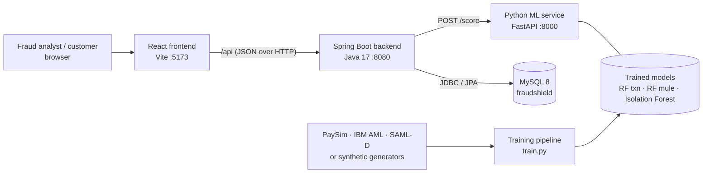

# FraudShield architecture

## Components



The same picture as text (for reports that cannot render Mermaid):

```
 Browser ──► React (5173) ──/api──► Spring Boot (8080) ──JDBC──► MySQL 8
                                        │
                                        └──POST /score──► FastAPI ML (8000) ──► RF + RF + IsolationForest
                                                                   ▲
                       Kaggle CSVs / synthetic generators ──► train.py
```

| Component | Technology | Responsibility |
|---|---|---|
| Frontend | React 18, React Router, Recharts, Cytoscape.js | Dashboard, transfers with OTP, accounts, history, review queue, alerts, money-flow graph, scenarios, model metrics, audit log |
| Backend | Java 17, Spring Boot 3.5, Spring Data JPA, Bean Validation | REST API, rule engine, risk combination, decisions, OTP, holds, execution with locking, idempotency, alerts, graph tracing, audit |
| ML service | Python, pandas, NumPy, scikit-learn, FastAPI | Feature engineering shared by training and serving, transaction model, mule model, anomaly model, explanations |
| Database | MySQL 8 (H2 in MySQL mode for tests) | accounts, transactions, risk_assessments, alerts, otp_challenges, audit_logs |

## Portals, roles and security

| Role | Portal (React) | Backend access |
|---|---|---|
| CUSTOMER | `src/customer/CustomerApp.jsx`: consumer banking app | `/api/me/**` only, always scoped to the user's own linked account |
| ANALYST | Fraud Analyst console (navy) | Monitoring, review, alerts, account status, escalation |
| INVESTIGATOR | Investigation portal (teal) | Read-only tracing, cases, audit log; cannot approve, freeze or move money |
| ADMIN | Administration (purple) | Users, settings, simulation lab, operations transfers, and every staff screen |

- **Sign-in:** passwords are stored as PBKDF2-HMAC-SHA256 with a per-user salt. Login returns a random 256-bit bearer
  token; only its SHA-256 is stored (`auth_tokens`). Sessions last 8 hours, and logout deletes the token.
- **Authorisation:** `AuthInterceptor` resolves the token on every `/api` call. `@RequireRole` on controllers and
  methods decides access (401 without a valid session, 403 for the wrong role). Customer endpoints check that every
  transaction belongs to the caller's own account (another customer's transaction returns 404).
- **Hand-offs between portals:** a customer's self-report ("asked to move money") raises an alert and opens an
  investigation case. An analyst escalates an account into a case. The investigator works the case and records
  findings. Every step is in the audit log, including who opened a case file.

## Transfer request flow

```mermaid
sequenceDiagram
    participant UI as React
    participant API as Spring Boot
    participant R as RuleEngine
    participant ML as ML service
    participant DB as MySQL
    UI->>API: POST /api/transactions (Idempotency-Key)
    API->>DB: key already used? -> return original (no new charge)
    API->>API: validate accounts, status, balance
    API->>R: fan-in, rapid onward, chain depth, drain, new payee, velocity, flagged parties
    API->>ML: transaction + 30-day history of both parties + 48h network edges
    ML-->>API: P(fraud), P(mule) sender/receiver, anomaly, reasons
    API->>API: weighted score + overrides -> ALLOW / MFA / HOLD / BLOCK
    API->>DB: save transaction, risk assessment, alerts, audit (one DB transaction)
    alt ALLOW
        API->>DB: execute (lock accounts, move money)
    else MFA
        API-->>UI: OTP challenge (demo: shown in SMS simulator)
        UI->>API: POST /otp/verify -> execute on success, reject after 3 failures
    else HOLD
        API-->>UI: held for analyst; expires unexecuted after 24h
    else BLOCK
        API-->>UI: blocked; never executes
    end
```

## Risk scoring

```
final = 0.30 × P(fraud | transaction RF)
      + 0.30 × max(P(mule | sender), P(mule | receiver))      graph-feature RF
      + 0.10 × anomaly (Isolation Forest, normalised 0..1)
      + 0.30 × rule score (capped sum of fired rule weights)

ALLOW < 0.30 ≤ MFA < 0.55 ≤ HOLD < 0.80 ≤ BLOCK
```

Overrides applied after the thresholds, in this order:

1. Receiver account frozen → **BLOCK**.
2. Rule score ≥ 0.80 → at least **BLOCK**. Rule score ≥ 0.55 → at least **HOLD**.
3. Large new payee, account-draining transfer, or receiver with fan-in → at least **MFA** (step-up authentication).
4. ML service unreachable → decide on rules only, at least **MFA** (fail-safe).

### Rules (backend `RuleEngine`)

| Code | Weight | Signal |
|---|---|---|
| RECEIVER_FAN_IN | 0.25 / 0.35 | Receiver paid by ≥3 / ≥5 distinct accounts in 24h |
| SENDER_FAN_IN | 0.25 | Sender collected from ≥3 distinct accounts in 24h |
| RAPID_ONWARD | 0.35 | Sending ≥70% of what arrived in the last 2h (≥ Rs 5,000) |
| MULTI_STAGE_CHAIN | 0.20 / 0.30 | Funds reached the sender through a 3+ / 4+ hop chain within 24h |
| NEW_ACCOUNT_PASS_THROUGH | 0.10 | Account < 30 days old behaving as a pass-through |
| DRAINS_ACCOUNT | 0.15 | Transfer ≥90% of balance (≥ Rs 10,000) |
| NEW_PAYEE_LARGE | 0.10 | First-ever payment to this receiver, ≥ Rs 50,000 |
| HIGH_VELOCITY | 0.15 | ≥5 outgoing transfers in the last hour |
| RECEIVER_FLAGGED | 0.40 | Receiver under review or has open high/critical alerts |
| SENDER_UNDER_REVIEW | 0.30 | Sender under review |
| RECEIVER_FROZEN | hard block | Receiver frozen |

### ML models

| Model | Data | Features | Purpose |
|---|---|---|---|
| Random Forest (transaction) | PaySim TRANSFER/CASH_OUT | Amount, hour, night, amount/balance, drains account, sender/receiver balance profile. Post-transaction balances and `isFlaggedFraud` excluded (label leakage) | Account-takeover style fraud |
| Random Forest (account) | IBM AML / SAML-D edges | 24h graph features per account: fan-in, fan-out, counts, volumes, pass-through ratio, minimum hold time, upstream chain depth, share of new counterparties | Money-mule behaviour |
| Isolation Forest | Same graph features, normal accounts only | Same as above | Unsupervised behavioural anomaly |

`fraudshield_ml/features.py` is used by **both** training and online scoring, so serving features are computed
exactly as in training. The backend sends the two parties' 30-day history plus 48 hours of network activity, so
relationship-age features match training.

## Transaction state machine

```
             ┌────────► COMPLETED (only via ExecutionService, from APPROVED)
 ALLOW ──► APPROVED ──┤
 MFA ───► PENDING_MFA ──OTP ok──► APPROVED      ──3 wrong──► REJECTED
 HOLD ──► HELD ──analyst approve──► APPROVED    ──reject──► REJECTED   ──24h──► EXPIRED
 BLOCK ─► BLOCKED (terminal)
 APPROVED ──insufficient funds / frozen at execution──► FAILED
```

Guarantees:

- **Prevention:** money moves only in `ExecutionService.execute`, which accepts only `APPROVED`. BLOCKED, REJECTED,
  EXPIRED and still-HELD transfers cannot execute; tests and the end-to-end suite try and get HTTP 409.
- **Consistent balances:** execution locks both account rows (`SELECT … FOR UPDATE`, ordered by id to avoid
  deadlocks) before the transaction row. A DB `CHECK` keeps balances ≥ 0, and `@Version` adds optimistic checks.
  Tested with 25 concurrent transfers: exactly 10 of Rs 1,000 succeed from Rs 10,000, and money is conserved.
- **No duplicates:** every transfer needs an `Idempotency-Key` (a unique DB column). A replay returns the original
  with `Idempotent-Replay: true`. Reusing a key with a different payload returns 409. Concurrent replays are resolved
  by the unique constraint.

## Money-flow tracing and role classification (`GraphService`)

- **Graph:** accounts are nodes; transfers are directed edges with amount, timestamp, status and decision. Breadth-first
  search out to N hops from an account.
- **Trace:** upstream sources and **time-respecting** downstream paths (each hop after the money arrived), including
  stopped attempts. The endpoints where money rests are listed as investigator leads.
- **Role heuristics:** these describe behaviour, not guilt.
  - `LIKELY_UNWITTING_MULE`: fan-in ≥3, tries to forward ≥70% within 4h, and is a new or quiet account.
  - `MULE_PATTERN_REVIEW`: the same behaviour on an established account, so review for complicity.
  - `LAYERING_HOP`, `LIKELY_COLLECTOR` (downstream lead toward the organiser) and `POSSIBLE_VICTIM`.

This answers the problem statement directly: the intermediary is flagged as a probable victim of the scam, not the
mastermind. The money is frozen in a traceable place, and the trace shows every victim and every onward account.
